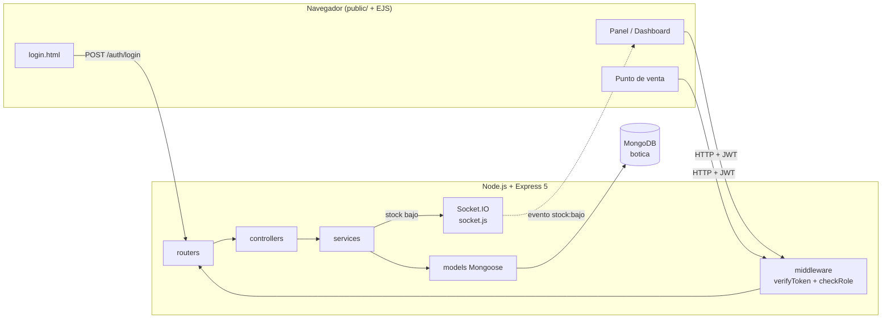
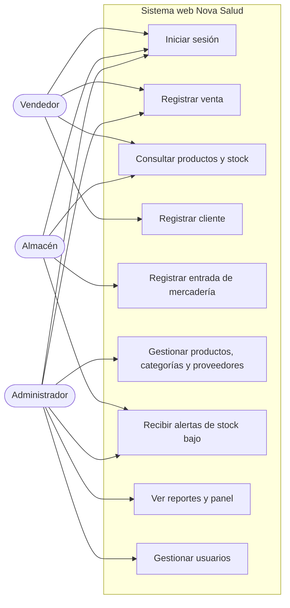
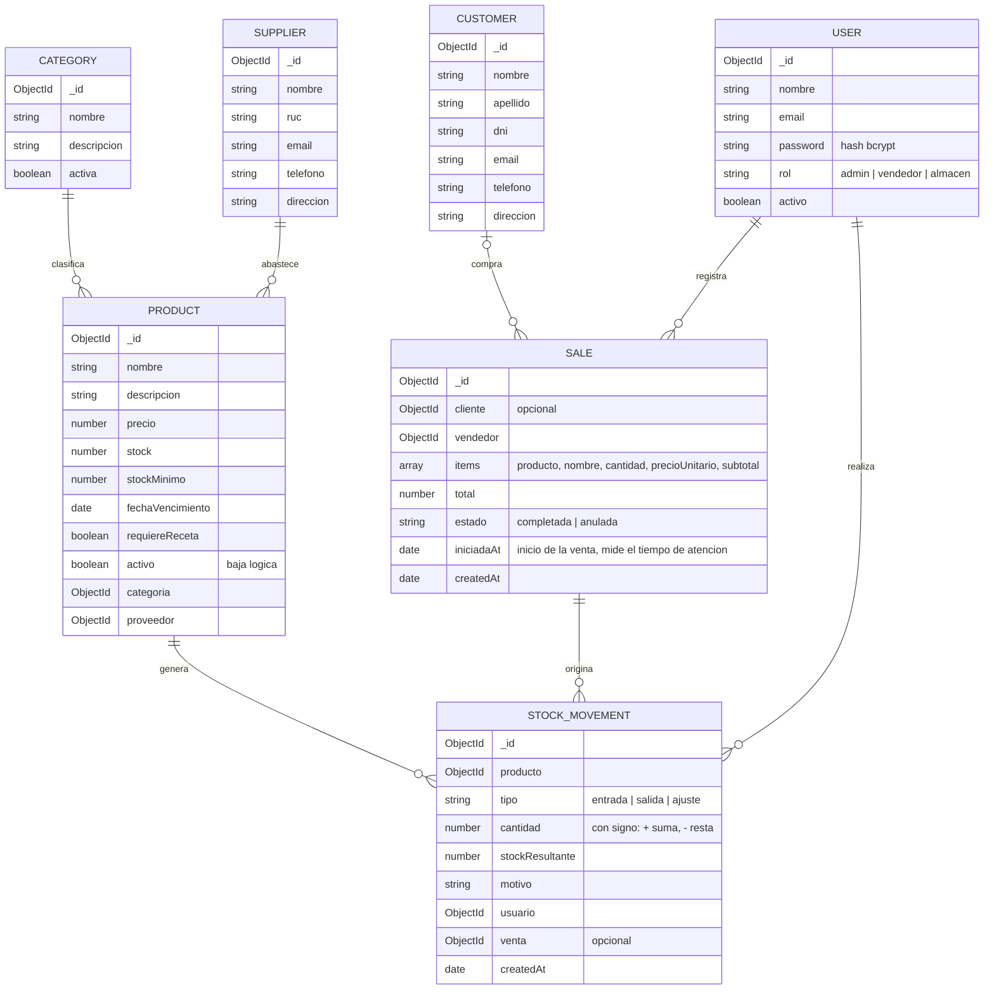
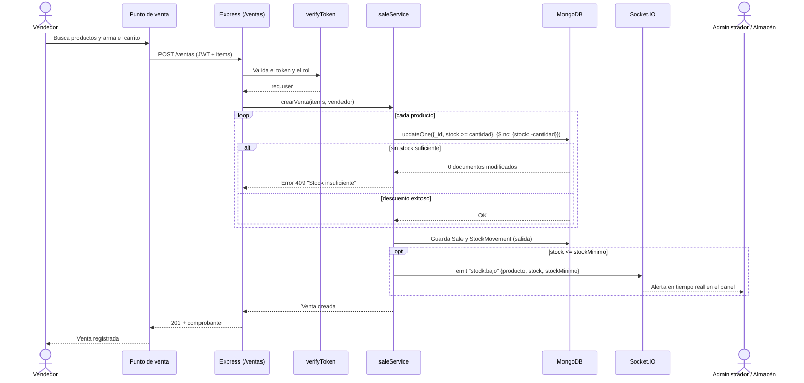

# Propuesta de solución: Software web de gestión de inventario y venta para la botica "Nova Salud"

**Curso:** Fullstack Developer Software (SENATI) — Trabajo Final PIAD-527
**Stack base:** el del repositorio `my-nodejs` (Node.js + Express + MongoDB/Mongoose + JWT + Socket.IO)

> Nota: el enunciado menciona la botica "Nova Salud" en el caso práctico y "FarmaPlus" en las preguntas guía. Este documento usa **Nova Salud**. Conviene confirmar el nombre con el docente.

---

## 1. Resumen

Nova Salud controla hoy su stock y su atención de forma manual. Eso produce errores de conteo, desabastecimientos y colas largas. Se propone una **aplicación web centralizada** que:

- registra productos, categorías, proveedores y clientes;
- registra ventas y descuenta el stock automáticamente;
- avisa **en tiempo real** cuando un producto baja del stock mínimo;
- ofrece una pantalla de venta rápida para reducir el tiempo de atención;
- protege los datos con autenticación JWT, contraseñas cifradas y roles.

---

## 2. Stack tecnológico (tomado de `my-nodejs`)

| Capa | Tecnología | Uso en la propuesta |
|---|---|---|
| Servidor | Node.js + **Express 5** | API REST y servidor de archivos estáticos |
| Base de datos | **MongoDB + Mongoose 9** | Colecciones de productos, ventas, usuarios, etc. |
| Autenticación | **jsonwebtoken + bcrypt** | Login, token en `Authorization: Bearer`, contraseñas con hash |
| Tiempo real | **Socket.IO 4** | Alertas de stock bajo y actualización del panel |
| Vistas | HTML estático + JS en `public/` y **EJS** | Login, panel, punto de venta |
| Desarrollo | nodemon | Recarga automática |

### Arquitectura en capas (la misma del repo)

`router → controller → service → model`, más `middleware/` para autenticación y roles. Cada módulo (productos, ventas, etc.) repite ese patrón, igual que `productRouters.js`, `productController.js`, `productService.js` y `productModel.js` en el repo base.



---

## 3. Respuestas a las preguntas guía

### 3.1 Desafíos operativos sin un sistema automatizado

- **Errores de stock:** conteos manuales que no coinciden con lo que hay en estantería.
- **Desabastecimiento:** nadie detecta a tiempo que un medicamento se está acabando.
- **Esperas largas:** hay que buscar precio y disponibilidad a mano en cada venta.
- **Sin trazabilidad:** no se sabe quién vendió qué, ni cuándo salió cada unidad.
- **Productos vencidos:** sin control de fechas, se pierde mercadería.
- **Decisiones a ciegas:** sin datos de ventas no se sabe qué reponer ni en qué cantidad.

### 3.2 Características específicas del software

| # | Característica | Cómo cubre la necesidad |
|---|---|---|
| 1 | CRUD de productos con `stock` y `stockMinimo` | Control de inventario centralizado |
| 2 | Categorías, proveedores y clientes | Datos maestros ordenados |
| 3 | Registro de ventas con detalle por producto | Sistema de registro de ventas |
| 4 | Descuento automático de stock al vender | Evita errores manuales |
| 5 | Alertas de stock bajo en tiempo real | Condición 2 del caso |
| 6 | Control de fecha de vencimiento | Evita pérdidas de mercadería |
| 7 | Kardex (historial de movimientos de stock) | Trazabilidad y auditoría |
| 8 | Login con JWT y roles (administrador, vendedor, almacén) | Condición 1: seguridad de datos |
| 9 | Pantalla de venta con búsqueda rápida | Condición 3: interfaz intuitiva |
| 10 | Reportes y panel con indicadores | Decisiones con datos |

### 3.3 Impacto en desabastecimiento y servicio al cliente

- **Menos desabastecimiento:** cada venta actualiza el stock y, si queda en `stockMinimo` o menos, Socket.IO envía la alerta al panel de inmediato. Se repone antes de quedarse sin producto.
- **Menos errores:** el sistema descuenta el stock; ya no depende del conteo a mano.
- **Atención más rápida:** el vendedor busca el producto, ve precio y disponibilidad al instante y cierra la venta en pocos pasos.
- **Mejor experiencia:** hay menos faltantes de producto y las colas se acortan.

### 3.4 Beneficios adicionales para la competitividad

- Historial de compras por cliente, para ofrecer un servicio más personalizado.
- Reportes de productos más vendidos y de baja rotación, para comprar mejor.
- Evaluación de proveedores (frecuencia de compra, precios).
- Alertas de vencimiento próximo, para hacer promociones antes de perder el producto.
- Base para crecer: boleta electrónica, pagos digitales, delivery o venta en línea.

### 3.5 Métricas de efectividad

| Objetivo | Métrica | Cómo se mide |
|---|---|---|
| Tiempo de respuesta | Tiempo promedio por venta (segundos) | `createdAt` menos `iniciadaAt` de la venta (el panel lo calcula) |
| Tiempo de respuesta | Clientes atendidos por hora | Conteo de ventas por hora |
| Errores de inventario | % de diferencia entre stock del sistema y conteo físico | Inventario físico periódico |
| Errores de inventario | N.º de ajustes manuales en el kardex | Movimientos de tipo `ajuste` |
| Desabastecimiento | N.º de quiebres de stock al mes | Productos con `stock = 0` |
| Desabastecimiento | Tiempo entre alerta y reposición | Fecha de alerta vs. fecha de entrada de stock |
| Pérdidas | Valor de productos vencidos | Productos dados de baja por vencimiento |

Se recomienda medir un mes **antes** y un mes **después** de implantar el sistema.

---

## 4. Diseño de la solución

### 4.1 Casos de uso por rol



### 4.2 Modelo de datos (MongoDB / Mongoose)

Se reutilizan los modelos del repo (`Product`, `Category`, `Supplier`, `Customer`) y se amplían. `Sale` guarda sus líneas de detalle **embebidas**, lo cual es natural en MongoDB y evita una colección adicional.



Campos nuevos respecto al repo base:

- `Product`: `stockMinimo`, `fechaVencimiento`, `requiereReceta`, referencias a `categoria` y `proveedor`.
- `User` unificado con credenciales y `rol` (hoy el repo separa `User` y `UserAuth`).
- `Sale` y `StockMovement`: son modelos nuevos.

### 4.3 Flujo de una venta con alerta de stock bajo



La clave del diseño es el **descuento atómico**: `updateOne` con la condición `stock >= cantidad`. Dos vendedores que venden el último producto al mismo tiempo no pueden dejar el stock en negativo, porque solo uno de los dos descuentos se aplica. El esquema ya tiene `min: 0` en `stock`, y esto lo refuerza a nivel de operación.

### 4.4 Endpoints de la API

Todas las rutas, salvo el login, exigen `verifyToken`. La columna "Roles" indica quién puede usarlas.

| Módulo | Método y ruta | Descripción | Roles |
|---|---|---|---|
| Auth | `POST /auth/login` | Devuelve el JWT | público |
| Auth | `POST /auth/register` | Crea un usuario | admin |
| Productos | `GET /productos` | Lista con filtros (`?q=`, `?categoria=`) | todos |
| Productos | `GET /productos/bajo-stock` | Productos con `stock <= stockMinimo` | admin, almacén |
| Productos | `GET /productos/por-vencer` | Vencimiento en los próximos 30 días | admin, almacén |
| Productos | `POST / PUT / DELETE /productos/:id` | Alta, edición y baja | admin |
| Categorías | `/categorias` (CRUD) | Ya existe en el repo | admin |
| Proveedores | `/proveedores` (CRUD) | Ya existe en el repo | admin |
| Clientes | `/clientes` (CRUD) | Ya existe en el repo | admin, vendedor |
| Ventas | `POST /ventas` | Registra una venta y descuenta stock | admin, vendedor |
| Ventas | `GET /ventas` | Historial con filtro por fecha (el vendedor ve solo las suyas) | admin, vendedor |
| Ventas | `PATCH /ventas/:id/anular` | Anula y devuelve el stock | admin |
| Inventario | `POST /inventario/entrada` | Registra entrada de mercadería | admin, almacén |
| Inventario | `POST /inventario/ajuste` | Ajuste por conteo físico (motivo obligatorio) | admin |
| Inventario | `GET /inventario/kardex/:productoId` | Movimientos de un producto | admin, almacén |
| Usuarios | `GET /usuarios`, `PUT /usuarios/:id` | Gestión de cuentas (activar, cambiar rol) | admin |
| Reportes | `GET /reportes/resumen` | Ventas del día, tiempo de atención, más vendidos, quiebres | admin |

> La implementación está en este mismo repositorio; ver el [README](README.md) para ejecutarla.

### 4.5 Seguridad (condición 1 del caso)

Mejoras sobre el repo base, que usa valores de práctica:

| En el repo base | En la propuesta |
|---|---|
| Clave JWT fija `'secret-key'` en el código | `JWT_SECRET` en un archivo `.env` (ya está en `.gitignore`) |
| Token con expiración de 5 s (para pruebas) | Expiración de 8 h, ajustable con `JWT_EXPIRES_IN` |
| Rutas `/auth` y `/dashboard` desactivadas | Activas, y todas las rutas de negocio protegidas con `verifyToken` |
| Sin control de roles | Middleware `checkRole('admin', ...)` que lee `req.user.rol` |
| La contraseña se guarda con bcrypt | Se mantiene (`bcrypt`, 10 rondas) |
| Validación de entrada básica | Se mantienen las validaciones de Mongoose y se añaden límites en ventas (cantidad entera mayor a 0) |
| Login: si el email no existe responde 500 | Responde 401 con mensaje genérico, sin revelar si el usuario existe |

Recomendado además: `helmet` (cabeceras HTTP), `express-rate-limit` en `/auth/login` y `cors` solo si el frontend se sirve desde otro origen.

### 4.6 Interfaz (condición 3 del caso)

Pantallas en `public/` con HTML y JS, como el login y el panel del repo:

1. **Login** (`login.html`, ya existe).
2. **Punto de venta** (nueva): buscador de productos con autocompletado, carrito con cantidades editables, total a la vista y botón único "Registrar venta". Es la pantalla que reduce el tiempo de atención.
3. **Panel** (`panel.html`, se amplía): tarjetas con ventas del día, productos en alerta y productos por vencer. Las alertas llegan por Socket.IO sin recargar la página.
4. **Inventario**: tabla de productos con indicador de color (verde, amarillo cerca del mínimo, rojo en stock bajo).
5. **Mantenimientos**: formularios de productos, categorías, proveedores y clientes.

### 4.7 Alertas en tiempo real (condición 2 del caso)

El repo ya tiene la base: `socket.js` recibe la instancia `io` desde `app.js`. Se extiende así:

- Al conectarse, el cliente envía su JWT; el servidor lo valida y lo une a una sala según su rol (`admins`, `almacen`).
- Tras cada venta o ajuste, `saleService` emite `stock:bajo` a esas salas.
- El panel muestra una notificación y actualiza el contador de alertas.
- Al cargar la página, el panel consulta también `GET /productos/bajo-stock`, para ver las alertas que llegaron mientras estaba cerrado.

---

## 5. Estructura de carpetas

```
nova-salud/
├── app.js
├── socket.js                  # eventos Socket.IO (stock:bajo)
├── config.js
├── .env                       # JWT_SECRET, DB (fuera de git)
├── database/connection.js
├── middleware/
│   ├── verifyToken.js         # ya existe
│   └── checkRole.js           # nuevo
├── models/
│   ├── userModel.js           # unificado, con rol
│   ├── productModel.js        # + stockMinimo, vencimiento, refs
│   ├── categoryModel.js
│   ├── supplierModel.js
│   ├── customerModel.js
│   ├── saleModel.js           # nuevo
│   └── stockMovementModel.js  # nuevo
├── services/                  # lógica de negocio (saleService, inventoryService, ...)
├── controllers/
├── routers/
├── views/index.ejs
└── public/
    ├── login.html
    ├── panel.html
    ├── pos.html               # punto de venta (nuevo)
    ├── inventario.html        # nuevo
    ├── css/
    └── js/
```

---

## 6. Qué se reutiliza y qué se construye

| Ya existe en `my-nodejs` | Por construir |
|---|---|
| Servidor Express + Socket.IO en `app.js` | Módulo de ventas (modelo, servicio, controlador, router) |
| CRUD de productos, categorías, proveedores y clientes | Kardex y entrada de mercadería |
| Conexión a MongoDB con Mongoose | Campos `stockMinimo` y `fechaVencimiento` en productos |
| `verifyToken`, bcrypt y generación de JWT | `checkRole` y secreto en `.env` |
| Login y panel en HTML | Punto de venta, panel con alertas e inventario |
| Listeners básicos de Socket.IO | Emisión de `stock:bajo` y salas por rol |

---

## 7. Plan de implementación

| Fase | Contenido | Resultado |
|---|---|---|
| 1. Base y seguridad | Activar `/auth`, mover secretos a `.env`, rol de usuario, `checkRole` | Login funcional con roles |
| 2. Inventario | Ampliar `Product`, endpoints de bajo stock y por vencer, entradas de mercadería, kardex | Inventario centralizado |
| 3. Ventas | `Sale`, `saleService` con descuento atómico, anulación | Registro de ventas |
| 4. Alertas | Autenticación en Socket.IO, evento `stock:bajo` | Reposición oportuna |
| 5. Interfaz | `pos.html`, panel e inventario | Atención más ágil |
| 6. Pruebas y entrega | Pruebas de los flujos de venta y de stock bajo, datos de ejemplo, documento final | Entregable |

---

## 8. Cumplimiento del enunciado

| Requisito del caso | Dónde se cubre |
|---|---|
| Software web centralizado de inventario, ventas y atención | Secciones 2, 4.2, 4.4 |
| Accesible desde la web y con datos seguros | Sección 4.5 |
| Módulo de alertas por bajo stock | Secciones 4.3 y 4.7 |
| Interfaz intuitiva que reduzca el tiempo de atención | Sección 4.6 |
| Sistema de registro de ventas | Secciones 4.2 y 4.3 |
| Optimizar la gestión interna y reducir errores | Descuento atómico, kardex y vencimientos |
| Preguntas guía | Sección 3 |
| Esquemas y diagramas | Secciones 2, 4.1, 4.2 y 4.3 |

*Los diagramas están escritos en Mermaid. Se visualizan en GitHub, en VS Code con la extensión "Markdown Preview Mermaid Support" o pegándolos en <https://mermaid.live>.*
