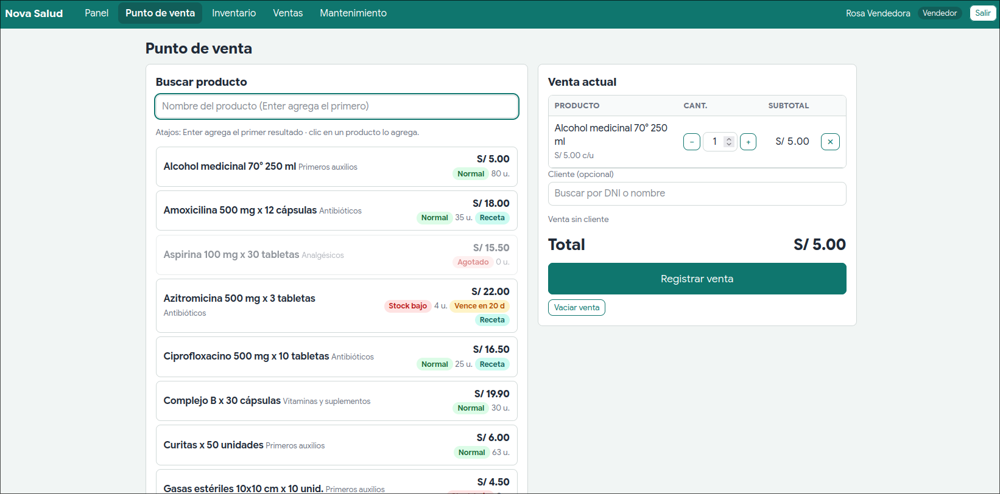
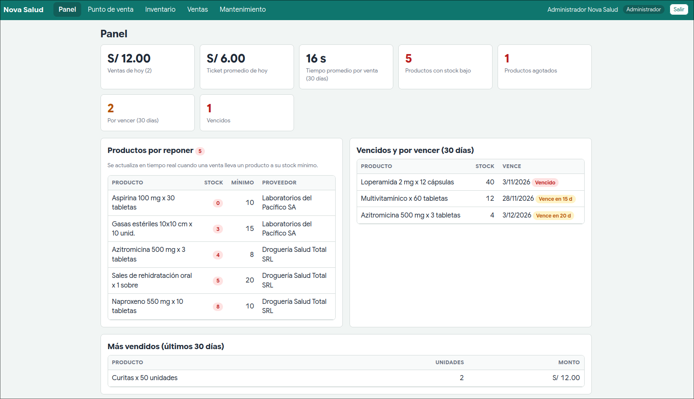
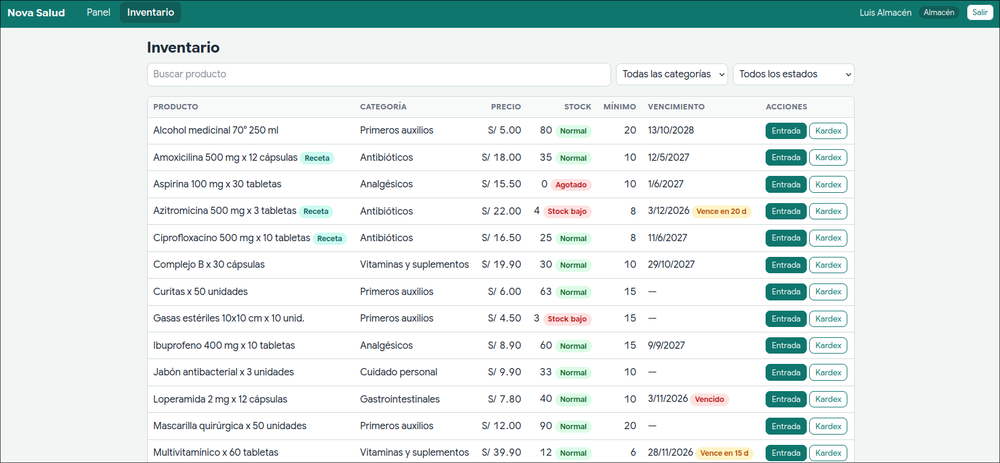

# Nova Salud — gestión de inventario y venta

Software web para una botica: inventario centralizado, registro de ventas con descuento automático de stock, alertas de reposición en tiempo real y una pantalla de venta rápida. Implementa la propuesta de [PROPUESTA_NOVA_SALUD.md](PROPUESTA_NOVA_SALUD.md).

**Stack:** Node.js + Express 5 · MongoDB + Mongoose · JWT + bcrypt · Socket.IO · HTML/JS en `public/` y EJS.

## Puesta en marcha

Requisitos: Node.js y MongoDB en ejecución (por defecto `mongodb://127.0.0.1:27017`).

```bash
npm install
cp .env.example .env     # y completar JWT_SECRET (el comando para generarlo está en el archivo)
npm run seed             # datos de ejemplo (usuarios, productos, clientes...)
npm start                # http://localhost:3000
```

Usuarios de ejemplo (creados por `npm run seed`; la contraseña es `SEED_PASSWORD` o `NovaSalud2026!` si no se define):

| Rol | Email |
|---|---|
| Administrador | `admin@novasalud.pe` |
| Vendedor | `vendedor@novasalud.pe` |
| Almacén | `almacen@novasalud.pe` |

Son cuentas de desarrollo: cámbialas o desactívalas antes de usar el sistema con datos reales. `node seed.js --reset` borra la base y vuelve a cargar los datos de ejemplo.

## Pruebas

```bash
MONGO_URI_TEST=mongodb://127.0.0.1:27017/nova_salud_test npm test
```

Las pruebas **borran** la base indicada en `MONGO_URI_TEST` (por defecto `nova_salud_test`); no la apuntes a datos reales. Cubren login, roles, ventas, stock insuficiente, ventas simultáneas de la última unidad, alertas Socket.IO, anulaciones, kardex y reportes.

## Pantallas

| Ruta | Quién | Para qué |
|---|---|---|
| `/login.html` | todos | Iniciar sesión |
| `/panel.html` | todos | Indicadores, productos por reponer y por vencer (en tiempo real) |
| `/pos.html` | admin, vendedor | Punto de venta: buscar, armar carrito, registrar |
| `/inventario.html` | todos (acciones según rol) | Stock con semáforo, entradas, ajustes, kardex, alta/edición de productos |
| `/ventas.html` | admin, vendedor | Historial, detalle y anulación (solo admin) |
| `/mantenimiento.html` | admin (y clientes para vendedor) | Clientes, categorías, proveedores y usuarios |

## Capturas

Punto de venta con una venta en curso (sesión de vendedor):



Panel con indicadores, productos por reponer y por vencer (sesión de administrador):



Inventario con semáforo de stock y vencimientos (sesión de almacén, que solo ve Panel e Inventario):



## API

Todas las rutas, salvo `POST /auth/login`, exigen `Authorization: Bearer <token>`. Los errores salen como `{ "error": "mensaje" }`.

| Método y ruta | Descripción | Roles |
|---|---|---|
| `POST /auth/login` | Devuelve `{ token, usuario }` | público |
| `POST /auth/register` | Crea un usuario | admin |
| `GET /auth/me` | Usuario de la sesión | todos |
| `GET /usuarios`, `PUT /usuarios/:id` | Gestión de usuarios | admin |
| `GET /productos` (`?q=`, `?categoria=`) | Lista de productos activos | todos |
| `GET /productos/bajo-stock` | `stock <= stockMinimo` | admin, almacén |
| `GET /productos/por-vencer` (`?dias=30`) | Vencidos o por vencer | admin, almacén |
| `GET /productos/:id` | Detalle | todos |
| `POST / PUT / DELETE /productos` | Alta, edición, baja lógica | admin |
| `/categorias` | CRUD (lectura para todos) | admin escribe |
| `/proveedores` | CRUD | admin, almacén leen; admin escribe |
| `/clientes` | CRUD (borrar solo admin) | admin, vendedor |
| `POST /ventas` | Registra venta y descuenta stock | admin, vendedor |
| `GET /ventas` (`?desde=&hasta=&estado=`) | Historial (el vendedor ve solo las suyas) | admin, vendedor |
| `GET /ventas/:id` | Detalle | admin, vendedor |
| `PATCH /ventas/:id/anular` | Anula y devuelve el stock | admin |
| `POST /inventario/entrada` | Ingreso de mercadería | admin, almacén |
| `POST /inventario/ajuste` | Ajuste por conteo físico (motivo obligatorio) | admin |
| `GET /inventario/kardex/:productoId` | Movimientos de un producto | admin, almacén |
| `GET /reportes/resumen` | Indicadores del panel | admin |

Ejemplo de venta:

```json
POST /ventas
{ "items": [{ "producto": "<id>", "cantidad": 2 }], "cliente": "<id opcional>", "iniciadaEn": "2026-01-01T10:00:00Z" }
```

El precio siempre se toma de la base de datos. `iniciadaEn` (opcional) es el momento en que se empezó a armar la venta; el panel lo usa para calcular el tiempo promedio de atención.

## Tiempo real (Socket.IO)

El cliente se conecta con `io({ auth: { token } })`. Sin token válido la conexión se rechaza.

| Evento | Lo reciben | Cuándo |
|---|---|---|
| `stock:bajo` `{ id, nombre, stock, stockMinimo }` | admin, almacén | una venta o ajuste deja un producto en o bajo su mínimo |
| `stock:actualizado` `[{ id, stock }]` | todos | cambió el stock de uno o más productos |

## Decisiones de diseño

- **Sin sobreventa:** el stock se descuenta con `findOneAndUpdate({ stock: { $gte: cantidad } })`, que es atómico. Si una venta falla a mitad, los descuentos ya hechos se revierten. Se evitaron las transacciones de MongoDB porque exigen un conjunto de réplicas.
- **El stock no se edita directamente:** solo cambia con ventas, entradas y ajustes, y cada cambio queda en el kardex (`movimientos_stock`) con su saldo resultante. En el kardex `cantidad` lleva signo: positiva suma, negativa resta.
- **Seguridad:** secreto JWT en `.env`, contraseñas con bcrypt, `helmet`, límite de intentos de login, el mismo mensaje ante cualquier fallo de credenciales y roles verificados en el servidor. Cada petición confirma en la base que la cuenta sigue activa, así que desactivar un usuario corta su acceso de inmediato.
- **Capas:** `router → controller → service → model`, igual que el repo base `my-nodejs`.
- **Zona horaria:** "hoy" en el panel y en los filtros de fecha usa la hora del servidor.
